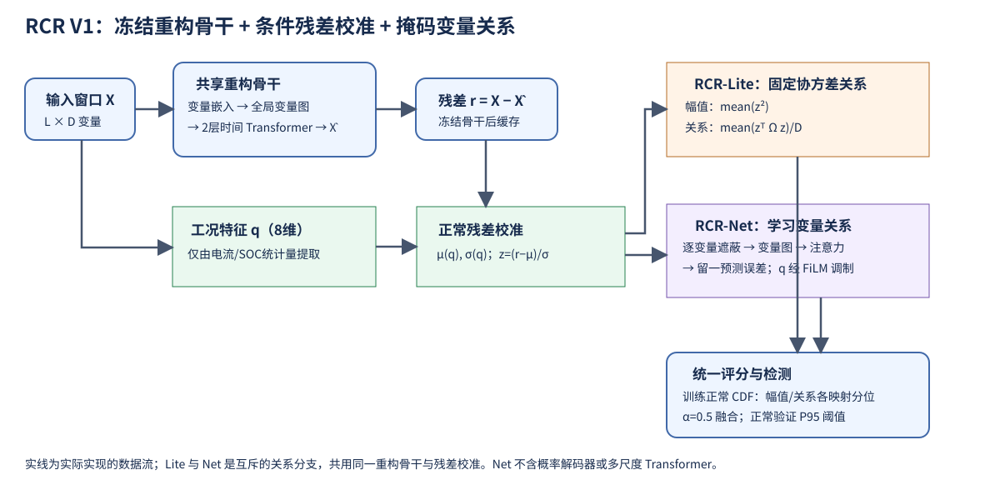

# RCR V1 模型与消融对比报告

**本报告只将已有完整评估指标的实验单元填为数值；Brand3 五折结果见下表。**

<!-- local-if-summary:start -->
**2026-10-24补充：本地原始 Isolation Forest 9/9 单元已完成并核验，已补入LFP/NCM与Brand3模型表，MSL/SMAP为P99补充表。**
IF不使用神经网络epoch：LFP/NCM的100k上限作用于正常训练点，其余神经参考模型作用于训练窗口；相同上限不等于相同信息或训练预算。
<!-- local-if-summary:end -->

## 模型架构与命名

这里的 CDF 是正常训练分数的经验累积分布函数：将分数映射为它在正常样本中的分位位置，再融合不同量纲的幅值与关系分数。例如 0.95 表示高于约 95% 的训练正常分数；它不是新模型，也不使用测试标签。极端值都可能映射到上界 1，故需注意饱和。

共享骨干为“变量嵌入 → 全局变量图 → 2 层时间 Transformer → 确定性重构”。残差经电流/SOC 的 8 维人工统计量做线性均值/尺度校准；这里没有可学习的条件编码器。Lite 用 Ledoit–Wolf 精度矩阵二次型衡量变量关系；Net 对每个残差坐标做遮蔽留一预测，使用一套共享变量图、1 层变量注意力及可选条件 FiLM。两条关系分支是互斥对照，不是串联；Raw、Scale、Lite、Net 共用骨干，不是四套独立模型。骨干先以 Huber 重构损失训练并冻结，Net 关系头随后以掩码预测 MSE 单独训练，因此当前模型不是重构损失与关系损失端到端联合优化。幅值与关系分数各由训练正常经验 CDF 映射后固定 α=0.5 融合，阈值只用正常验证集。**实际实现不含 TCN、可学习条件编码器、概率解码器、多尺度 Transformer、掩码邻接损失或原计划的 newC3 模块。**详见 [PROTOCOL.md](PROTOCOL.md)。

**工况消融**只保留完整Net与“Net无全部条件”，考察电流/SOC工况信息整体是否有效；one-hot、FiLM形式等细分设置移至详细归档。

**架构消融**固定工况定义与评分协议，移除或替换模型的结构部件：骨干变量图、时间 Transformer，以及 Lite/Net 关系建模。它检验表征与关系结构本身是否必要。前者改变“如何使用工况”，后者改变“由什么结构学习”。

实验采用正常充放电混合、VIN隔离，seed3407。RCR只在正常数据训练，epoch由正常验证loss选择；主融合alpha=0.5，阈值由正常验证片段P95/P99确定，不使用测试标签挑alpha、epoch或阈值。

## 比较边界

- † 为既有预算参考：10epoch、最多100k训练窗口；RCR为全量正常训练、backbone最多50epoch及关系头最多30epoch、patience8。两者不是等训练预算，不能将全部差异归因于结构。
- 主机制比较是同一冻结backbone与校准下的Raw/Scale/Lite/Net。Net是否超过Lite必须独立报告，不能只比较原MTAD-GAT。
- TranAD保留原生10点窗口，其余方法32点，stride4；测试使用共同长度至少32点的样本。LFP排除了TranAD独有的一个短片段，见参考产物记录。
- LFP/NCM分别训练，不是零样本迁移。单seed与反复使用公开研究队列限制确认性结论。

## Brand3 严格正常验证：五折结果

使用车辆隔离、训练集 MinMax、车辆 Top-5% 聚合和正常验证车辆 P95 阈值。下表为 fold 0–4 五折算术均值；单元格顺序为 AUROC / AP / F1 / Recall / FPR。**粗体**为该指标最高值（FPR 为最低值），不代表统计显著性或综合最优。PatchAD、DCdetector以及新增Deep SVDD使用128点窗口，其他既有神经模型使用127点窗口；IF使用128点展平输入。参考模型 10 epoch/最多 100k 窗口，与 RCR 全量训练预算不等。

| Brand3 方法 | fold 0–4 均值 |
| --- | --- |
| MTAD-GAT：变量/时间图注意力＋预测/重构 † | 0.9251 / 0.8714 / 0.5899 / 0.6000 / 0.1105 |
| TranAD：双阶段自条件 Transformer 重构 † | 0.8934 / 0.8509 / 0.6316 / 0.5778 / 0.1111 |
| Anomaly Transformer：时间关联差异检测 † | 0.7611 / 0.5473 / 0.1267 / 0.0889 / 0.0778 |
| DCdetector：双注意力对比检测 † | 0.1689 / 0.2330 / 0.0000 / 0.0000 / 0.0550 |
| PatchAD：多尺度 Patch 表征检测 † | 0.6767 / 0.6039 / 0.2291 / 0.1556 / **0.0444** |
| OmniAnomaly：概率 GRU-VAE 重构 † | 0.6815 / 0.4973 / 0.1379 / 0.0889 / 0.0778 |
| Isolation Forest：原始128点展平输入 § | 0.8296 / 0.7628 / 0.6100 / 0.5556 / 0.1439 |
| Deep SVDD：128点编码器＋固定中心距离 † | 待补 |
| Raw：变量图＋时间 Transformer 重构误差 | **0.9255** / 0.8680 / 0.6851 / 0.6667 / 0.1327 |
| Scale：Raw 残差经工况均值/尺度校准 | 0.9240 / **0.8728** / **0.7236** / **0.6889** / 0.0994 |
| RCR-Lite：校准幅值＋固定协方差关系融合 | 0.9120 / 0.8543 / 0.7007 / 0.6667 / 0.1111 |
| Lite 无条件：全局残差校准＋固定协方差关系 | 0.9146 / 0.8615 / 0.6855 / 0.6444 / 0.1111 |
| RCR-Net：校准幅值＋条件 FiLM 掩码变量关系网络 | 0.9118 / 0.8561 / 0.6294 / 0.5778 / 0.1000 |

五折中，Raw平均AUROC最高（0.9255），Scale平均F1最高（0.7236）。Net的F1低于Lite（0.6294对0.7007），不支持更复杂关系头稳定更好。主表保留Raw、Scale、Lite、无工况Lite和Net；细粒度结构与调制对照见[消融详细归档](RCR_ABLATION_DETAIL_20261024.md)。

<!-- local-if-brand3-note:start -->
§ IF 为本地 seed3407、200 棵树、最多100k训练输入的补充参考。Brand3 使用严格正常车辆五折、fold seed=0、`paper_channel` 归一化、128点展平输入与固定车辆Top-5%聚合；表中P95由已保存模型在正常验证车辆上重新计算，未重训、未按测试标签选阈值。**本报告其余 Brand3 模型使用 MinMax，因此该行预处理不同，不纳入原表粗体最优标记。** 本地原P99结果另行保留；P95五折指标为 AUROC/AP/F1/Recall/FPR，均值已列于表内。
<!-- local-if-brand3-note:end -->

<!-- local-if-public:start -->

## MSL/SMAP：本地原始 IF / Deep SVDD 补充参考（正常验证 P99）

逐实体时间90/10正常训练/验证划分，均为全通道，不做point adjustment；IF逐点评分，Deep SVDD为32点窗口。本表是独立P99补充口径，不能与上方电池P95工作点或其他输出通道范围的模型直接拼接。

| 模型 | MSL | SMAP |
| --- | --- | --- |
| Isolation Forest：原始变量逐点评分 | 0.6056 / 0.1455 / 0.0593 / 0.0328 / 0.0088 | 0.6323 / 0.1578 / 0.0116 / 0.0061 / 0.0069 |
| Deep SVDD：32点编码器＋固定中心距离 † | 待补 | 待补 |

单元格顺序与主表一致：AUROC / AP / F1 / Recall / FPR。完整P/R/F1、五折明细与产物见 [本地IF报告](../if_raw_and_vi_response_20261024/RAW_IF.md)。电压—电流响应诊断按要求不纳入本报告结果表。
<!-- local-if-public:end -->

<!-- deep-svdd-protocol:start -->
Deep SVDD沿用现有实现：5 epoch自编码器预训练＋10 epoch固定中心紧致性训练，最多100k正常训练窗口、seed3407。LFP/NCM使用原VIN隔离与P95/P99；MSL/SMAP为全通道32点窗口、stride4、正常验证P99，无point adjustment；Brand3使用严格正常验证五折、fold seed0、训练正常MinMax、128点窗口、stride4、车辆Top-5%与正常验证车辆P95。与本地IF的逐点输入或Brand3 paper_channel预处理有差异，已保留区别；不把Deep SVDD编码器距离当作信号MSE。
<!-- deep-svdd-protocol:end -->

## 正常验证P95阈值结果

单元格顺序：AUROC / AP / F1 / Recall / FPR。全部为比例；**粗体**为本表该数据集、该指标的最优数值（并列均标），不代表统计显著性或综合最优。`‡` 表示仅有汇总指标的初步结果，暂不用于确认性结论。

| 模型/消融 | LFP | NCM |
| --- | --- | --- |
| MTAD-GAT：变量/时间图注意力＋预测/重构 † | 0.6231 / 0.7245 / 0.3638 / 0.2318 / 0.0531 | 0.7400 / 0.8029 / 0.5042 / 0.3462 / 0.0338 |
| TranAD：双阶段自条件 Transformer 重构 † | 0.7457 / 0.7814 / 0.3380 / 0.2117 / 0.0512 | 0.7288 / 0.7922 / 0.4657 / 0.3161 / 0.0517 |
| Anomaly Transformer：时间关联差异检测 † | 0.8137 / 0.8240 / 0.4223 / 0.2780 / **0.0481** | 0.4699 / 0.5625 / 0.0611 / 0.0322 / **0.0285** |
| DCdetector：双注意力对比检测 † | 0.4656 / 0.5330 / 0.0554 / 0.0296 / **0.0481** | 0.5607 / 0.5925 / 0.1071 / 0.0587 / 0.0457 |
| PatchAD：多尺度 Patch 表征检测 † | 0.6645 / 0.6976 / 0.3379 / 0.2148 / 0.0700 | 0.4814 / 0.5582 / 0.0849 / 0.0455 / 0.0311 |
| OmniAnomaly：概率 GRU-VAE 重构 † | 0.5922 / 0.6759 / 0.2761 / 0.1681 / 0.0619 | 0.7023 / 0.7581 / 0.3226 / 0.1977 / 0.0351 |
| Isolation Forest：原始变量逐点评分 † | 0.6619 / 0.7157 / 0.3268 / 0.2047 / 0.0600 | 0.5249 / 0.5624 / 0.0667 / 0.0354 / 0.0338 |
| Deep SVDD：预训练编码器＋固定中心距离 † | 0.8058 / 0.8405 / 0.5135 / 0.3618 / 0.0587 | 待补 |
| Raw：变量图＋时间 Transformer 重构误差 | 0.6147 / 0.7387 / 0.4521 / 0.3056 / 0.0575 | 0.7931 / 0.8602 / 0.6777 / 0.5412 / 0.0702 |
| Scale：Raw 残差经工况均值/尺度校准 | 0.7715 / 0.8113 / 0.4656 / 0.3171 / 0.0563 | 0.8189 / 0.8755 / 0.6831 / 0.5412 / 0.0543 |
| RCR-Lite：校准幅值＋固定协方差关系融合 | 0.7565 / 0.8024 / 0.4505 / 0.3036 / 0.0550 | 0.8212 / **0.8768** / **0.6853** / **0.5444** / 0.0556 |
| RCR-Net：校准幅值＋条件 FiLM 掩码变量关系网络 | 0.7765 / 0.8235 / 0.4882 / 0.3362 / 0.0512 | **0.8231** / 0.8762 / 0.6810 / 0.5375 / 0.0517 |
| Net 无全部条件：全局残差校准＋无 FiLM 关系头 | 0.7732 / 0.8167 / 0.4760 / 0.3261 / 0.0550 | 0.8049 / 0.8655 / 0.6776 / 0.5359 / 0.0576 |
| Raw 无骨干变量图：无图重构骨干误差 | 0.7894 / 0.8219 / 0.4615 / 0.3131 / 0.0544 | 0.7757 / 0.8397 / 0.5981 / 0.4440 / 0.0510 ‡ |
| A1：仅变量图骨干（移除时间 Transformer）的原始重构误差 | **0.8509** / **0.8664** / **0.5277** / **0.3733** / 0.0519 | 0.7106 / 0.7486 / 0.2528 / 0.1485 / 0.0331 ‡ |

## 代表性消融：按模块有无理解

主表只保留7个代表性RCR设置。`✓`为有，`—`为无；关系分支不同类型单独注明。

| 代表设置 | 骨干变量图 | 时间Transformer | 电流/SOC工况信息 | 关系分支 | 主要检验问题 |
| --- | :---: | :---: | :---: | --- | --- |
| Raw | ✓ | ✓ | — | — | 仅重构骨干的基准 |
| Scale | ✓ | ✓ | ✓ | — | 相对Raw，工况校准是否有效 |
| RCR-Lite | ✓ | ✓ | ✓ | 固定协方差 | 相对Scale，简单关系是否增益 |
| RCR-Net | ✓ | ✓ | ✓ | 掩码关系网络 | 相对Scale，学习关系是否增益 |
| Net 无全部条件 | ✓ | ✓ | — | 掩码关系网络 | 相对Net，整体工况信息是否必要 |
| Raw 无骨干变量图 | — | ✓ | — | — | 相对Raw，骨干变量图是否必要 |
| A1：移除时间Transformer | ✓ | — | — | — | 相对Raw，时间建模是否必要 |

“Net无全部条件”仍使用全局残差校准，只移除电流/SOC条件与FiLM；不能写成完全无校准。两个骨干删模块实验使用原始重构评分，只能分别与Raw作结构对照，不能与完整Net直接相减后归因于一个模块。A1在LFP的AP/F1为0.8664/0.5277，高于Raw的0.7387/0.4521；NCM的A1反而低于Raw，尚不支持时间Transformer在所有体系上都应删除。

NCM骨干删模块行的`‡`仍表示仅有汇总指标，尚缺完整评估文件。当前报告已将one-hot、线性FiLM、CDF细节、尺度下限扫描和关系头内部结构对照移出主表；完整数值保留在[消融详细归档](RCR_ABLATION_DETAIL_20261024.md)，原实验产物不删除。

机制诊断保留两点：当前Scale的主要收益来自条件去均值，尺度路径因下限过大而几乎退化为常数；第二个关系变量图在已有单seed对照中没有显示稳定增益。这些是后续简化候选依据，仍需多seed验证。

## 预设主比较：RCR-Net − RCR-Lite

- LFP：auroc +0.0199, ap +0.0211, f1 +0.0377, recall +0.0326, fpr -0.0038。
- NCM：auroc +0.0019, ap -0.0007, f1 -0.0043, recall -0.0069, fpr -0.0040。

上述差值不自动证明成功。尤其F1/Recall提高若伴随FPR上升，不是等误报预算增益；单个setting正向也不满足方案要求的跨setting稳定优势。

## 低动态高内阻与其他故障

主机制四组的分层表保持同一个正常验证阈值；不在组内重调阈值。单元格为 Recall / 同工况正常 FPR / AUROC。**粗体**为同一故障分层、同一数据集各指标的最优值（并列均标）；低 FPR 不等于高综合检测能力。

### 放电低动态 high-resistance

| 方法 | LFP | NCM |
| --- | --- | --- |
| Raw（共享backbone） | 0.7889 / 0.0375 / 0.9487 | 0.4222 / 0.0488 / 0.7289 |
| Scale（条件均值/尺度） | 0.8111 / 0.0387 / 0.9792 | 0.4556 / 0.0413 / 0.7941 |
| RCR-Lite | 0.7667 / 0.0338 / 0.9712 | **0.5222** / **0.0338** / 0.8009 |
| RCR-Net | **0.8333** / **0.0312** / **0.9868** | **0.5222** / 0.0362 / **0.8071** |

### 放电全部 high-resistance

| 方法 | LFP | NCM |
| --- | --- | --- |
| Raw（共享backbone） | 0.8633 / 0.0375 / 0.9763 | 0.5167 / 0.0488 / 0.7688 |
| Scale（条件均值/尺度） | 0.9067 / 0.0387 / 0.9894 | 0.5400 / 0.0413 / 0.8259 |
| RCR-Lite | 0.8600 / 0.0338 / 0.9854 | 0.5700 / **0.0338** / 0.8324 |
| RCR-Net | **0.9233** / **0.0312** / **0.9935** | **0.5767** / 0.0362 / **0.8373** |

### 放电 low-capacity

| 方法 | LFP | NCM |
| --- | --- | --- |
| Raw（共享backbone） | 0.0367 / 0.0375 / 0.3115 | **0.7133** / 0.0488 / 0.9101 |
| Scale（条件均值/尺度） | 0.0400 / 0.0387 / 0.6418 | **0.7133** / 0.0413 / 0.9312 |
| RCR-Lite | **0.0467** / 0.0338 / 0.6520 | **0.7133** / **0.0338** / **0.9356** |
| RCR-Net | **0.0467** / **0.0312** / **0.6652** | 0.6967 / 0.0362 / 0.9336 |

### 放电 self-discharge

| 方法 | LFP | NCM |
| --- | --- | --- |
| Raw（共享backbone） | 0.1950 / 0.0375 / 0.7730 | 0.1875 / 0.0488 / 0.6001 |
| Scale（条件均值/尺度） | 0.2350 / 0.0387 / 0.8394 | 0.1825 / 0.0413 / 0.6075 |
| RCR-Lite | 0.1950 / 0.0338 / 0.8411 | 0.1875 / **0.0338** / 0.6089 |
| RCR-Net | **0.2450** / **0.0312** / **0.8601** | **0.1900** / 0.0362 / **0.6128** |

## 解释边界

LFP部分样本存在CDF饱和；RCR与历史参考模型训练预算不等，单seed结果不能直接证明结构贡献。完整诊断、细粒度消融与原始说明见[消融详细归档](RCR_ABLATION_DETAIL_20261024.md)。

<!-- calibration-distribution-validation:start -->
## 校准前后残差分布验证

固定已有骨干、校准参数和数据划分，仅复算缓存，不重新训练或调参。完整报告及8组PNG/PDF见[校准前后分布诊断](../rcr_calibration_distribution_20261024/README.md)。下表比较共享骨干的Raw与Scale幅值评分，不代表RCR-Net整体结构的对比结果。

| 诊断（原始 → 校准） | LFP | NCM |
| --- | --- | --- |
| 正常有符号残差均值的工况η²，越低越好 | 0.1985 → 0.0501 | 0.2485 → 0.0650 |
| 正常残差标准化Wasserstein，越低越好 | 0.4810 → 0.3867 | 0.4602 → 0.2960 |
| 整体AUROC | 0.6147 → 0.7715 | 0.7931 → 0.8189 |
| 整体AP | 0.7387 → 0.8113 | 0.8602 → 0.8755 |
| 正常最终log幅值评分的工况η² | 0.2175 → 0.2156 | 0.1740 → 0.1234 |
| 粗分层AUROC下降数（充放电×故障类型） | 0/6 | 0/6 |
| 细工况组AUROC下降数 | 1/41 | 15/43 |

**结论：正常残差均值的工况差异缩小，整体故障可分性改善；全局收益和局部损失同时存在。** LFP最终幅值评分的工况依赖仍明显。NCM放电、电流低分位/SOC中分位的高内阻组，AUROC由0.8347降至0.7849；ΔAUROC的VIN配对95%区间为[−0.0907, −0.0136]，正常/故障片段85/78、车辆45/26。NCM共有4个细工况组的未校正区间完全低于0。这些是事后探索结果，未作多重比较校正；粗分箱也不等于连续工况严格匹配，需要独立数据确认。

机制检查发现，两体系现有尺度σ均约为0.05，Scale排序与仅条件去均值相同，本轮收益主要来自去均值。给定工况和参数，校准变换可逆；局部下降指当前幅值评分的可分性损失，不能称为原始信息永久丢失。

可以据此提出研究问题：**如何消除正常工况偏置，同时保留不同工况下的故障证据？** 原始/校准残差并行、按正常条件支持度约束融合是待验证候选。应先排查尺度下限，再以相同骨干和预算进行模块对照及多seed、独立品牌验证；当前结果尚未证明新架构有效。

<!-- calibration-distribution-validation:end -->

<!-- local-wavelet-components:start -->
## CH-Battery 单小波分量跨模型对比

这些是固定seed、历史参考预算下的探索结果，不是与RCR等预算的确认性结构比较。

> 状态：进行中。指标顺序均为 `AP / AUROC / F1 / Recall / FPR`。

### 实验协议

- 模型：MTAD-GAT、TranAD、Anomaly Transformer、DCdetector、PatchAD、OmniAnomaly、Isolation Forest、Deep SVDD。
- 输入只包含单分量：Raw、A3、D3、D2、D1；不包含任何分量拼接或组合分数。
- `db4` 三级小波分解按样本、按变量独立执行，分量重构到原始时间长度后输入模型。
- Raw 保持原 RCR reference 输入；小波分量只用正常训练样本拟合分量 MinMaxScaler。
- VIN 划分固定为 seed 3407；深度基线沿用 RCR reference 的 10 epoch、最多 100k训练窗口预算。
- Deep SVDD新增10个单元，先做5 epoch自编码器预训练，再固定正常训练隐空间中心做10 epoch紧致性训练；保存最终编码器与中心。最终模型无信号解码器，MAE/MSE不适用。
- 样本分数为最高5%窗口分数均值；P95/P99阈值只由正常验证集确定。
- 跨模型结构和原生窗口不同，架构依据优先看每个模型相对自身 Raw 的变化。

- **粗体按行标记**：固定模型、化学体系和阈值，在该行Raw/A3/D3/D2/D1五种输入间分别比较每个指标；AP/AUROC/F1/Recall取最大，FPR取最小，并列均标。待补项不参与比较。不代表统计显著性。

### LFP，正常验证 P95 阈值

| 模型 | Raw | A3慢趋势 | D3较慢细节 | D2中速细节 | D1快速细节 |
|---|---:|---:|---:|---:|---:|
| MTAD-GAT | 0.7245 / 0.6231 / 0.3638 / 0.2318 / 0.0531 | **0.7555** / **0.6845** / **0.3804** / **0.2454** / 0.0556 | 0.6569 / 0.5130 / 0.3352 / 0.2107 / 0.0581 | 0.6786 / 0.5343 / 0.3430 / 0.2137 / **0.0406** | 0.6497 / 0.5219 / 0.2908 / 0.1791 / 0.0656 |
| TranAD | 0.7814 / 0.7457 / 0.3380 / 0.2117 / 0.0512 | **0.8015** / **0.7779** / **0.3870** / **0.2504** / 0.0544 | 0.6866 / 0.5768 / 0.2524 / 0.1480 / **0.0312** | 0.6922 / 0.6160 / 0.2365 / 0.1375 / **0.0312** | 0.6768 / 0.5811 / 0.2526 / 0.1485 / 0.0344 |
| Anomaly Transformer | **0.8240** / **0.8137** / **0.4223** / **0.2780** / **0.0481** | 0.6354 / 0.5395 / 0.2016 / 0.1179 / 0.0644 | 0.6598 / 0.5626 / 0.2835 / 0.1726 / 0.0563 | 0.6924 / 0.6003 / 0.3184 / 0.1967 / **0.0481** | 0.6496 / 0.6104 / 0.1963 / 0.1139 / 0.0581 |
| DCdetector | 0.5330 / 0.4656 / 0.0554 / 0.0296 / 0.0481 | 0.5595 / 0.4761 / 0.1005 / 0.0552 / 0.0531 | **0.7216** / **0.6515** / **0.3867** / **0.2489** / 0.0475 | 0.7136 / 0.6469 / 0.3384 / 0.2082 / **0.0281** | 0.6460 / 0.5942 / 0.0800 / 0.0426 / 0.0294 |
| PatchAD | **0.6976** / **0.6645** / **0.3379** / **0.2148** / 0.0700 | 0.6377 / 0.5874 / 0.1329 / 0.0733 / **0.0362** | 0.5242 / 0.4719 / 0.0298 / 0.0156 / 0.0375 | 0.5533 / 0.5006 / 0.0808 / 0.0442 / 0.0600 | 0.5703 / 0.5357 / 0.0900 / 0.0492 / 0.0544 |
| OmniAnomaly | 0.6759 / **0.5922** / 0.2761 / 0.1681 / 0.0619 | 0.6017 / 0.5190 / 0.1189 / 0.0662 / 0.0600 | 0.6618 / 0.5334 / 0.3208 / 0.1997 / 0.0563 | **0.6796** / 0.5567 / **0.3297** / **0.2057** / **0.0525** | 0.6659 / 0.5466 / 0.3111 / 0.1927 / 0.0575 |
| Isolation Forest | 0.7157 / 0.6619 / **0.3268** / **0.2047** / 0.0600 | **0.7183** / **0.6965** / 0.2526 / 0.1505 / 0.0512 | 0.6323 / 0.5191 / 0.2037 / 0.1174 / 0.0444 | 0.6222 / 0.5218 / 0.1815 / 0.1034 / 0.0444 | 0.6243 / 0.5358 / 0.1621 / 0.0913 / **0.0437** |
| Deep SVDD | **0.8405** / 0.8058 / 0.5135 / 0.3618 / **0.0587** | 0.8348 / **0.8069** / **0.5232** / **0.3728** / 0.0650 | 待补 | 待补 | 待补 |

### NCM，正常验证 P95 阈值

| 模型 | Raw | A3慢趋势 | D3较慢细节 | D2中速细节 | D1快速细节 |
|---|---:|---:|---:|---:|---:|
| MTAD-GAT | 0.8029 / 0.7400 / 0.5042 / 0.3462 / 0.0338 | **0.8348** / **0.7657** / **0.6442** / **0.5005** / 0.0669 | 0.5999 / 0.4870 / 0.1401 / 0.0772 / **0.0305** | 0.5815 / 0.4722 / 0.1697 / 0.0957 / 0.0397 | 0.5900 / 0.4764 / 0.1996 / 0.1163 / 0.0609 |
| TranAD | **0.7922** / **0.7288** / **0.4657** / **0.3161** / 0.0517 | 0.7155 / 0.6456 / 0.3615 / 0.2283 / 0.0437 | 0.5849 / 0.4694 / 0.1251 / 0.0682 / **0.0272** | 0.5854 / 0.4630 / 0.1678 / 0.0946 / 0.0417 | 0.5675 / 0.4705 / 0.1258 / 0.0692 / 0.0397 |
| Anomaly Transformer | 0.5625 / 0.4699 / 0.0611 / 0.0322 / 0.0285 | 0.5559 / **0.4743** / 0.0984 / 0.0534 / 0.0391 | **0.5818** / 0.4656 / 0.1282 / 0.0698 / **0.0238** | 0.5733 / 0.4690 / 0.1349 / 0.0745 / 0.0377 | 0.5694 / 0.4596 / **0.1375** / **0.0761** / 0.0384 |
| DCdetector | 0.5925 / 0.5607 / 0.1071 / 0.0587 / 0.0457 | 0.6429 / 0.5740 / 0.2169 / 0.1274 / 0.0589 | 0.5389 / 0.4825 / 0.0652 / 0.0349 / **0.0444** | 0.5810 / 0.5320 / 0.1180 / 0.0655 / 0.0563 | **0.6584** / **0.5785** / **0.3032** / **0.1855** / 0.0477 |
| PatchAD | **0.5582** / **0.4814** / 0.0849 / 0.0455 / **0.0311** | 0.5096 / 0.4373 / 0.0804 / 0.0439 / 0.0596 | 0.5288 / 0.4370 / **0.0881** / **0.0481** / 0.0556 | 0.5015 / 0.4278 / 0.0588 / 0.0317 / 0.0589 | 0.5345 / 0.4665 / 0.0698 / 0.0375 / 0.0477 |
| OmniAnomaly | **0.7581** / **0.7023** / **0.3226** / **0.1977** / 0.0351 | 0.7190 / 0.6885 / 0.1948 / 0.1110 / 0.0358 | 0.5845 / 0.4675 / 0.1359 / 0.0745 / **0.0278** | 0.5807 / 0.4690 / 0.1340 / 0.0735 / 0.0285 | 0.5811 / 0.4643 / 0.1508 / 0.0835 / 0.0305 |
| Isolation Forest | **0.5624** / **0.5249** / 0.0667 / 0.0354 / 0.0338 | 0.5512 / 0.5067 / 0.0531 / 0.0280 / 0.0338 | 0.5615 / 0.4428 / 0.1128 / 0.0613 / 0.0325 | 0.5515 / 0.4334 / 0.1055 / 0.0571 / **0.0311** | 0.5588 / 0.4336 / **0.1296** / **0.0714** / 0.0371 |
| Deep SVDD | 待补 | 待补 | 待补 | 待补 | 待补 |

### LFP，正常验证 P99 阈值

| 模型 | Raw | A3慢趋势 | D3较慢细节 | D2中速细节 | D1快速细节 |
|---|---:|---:|---:|---:|---:|
| MTAD-GAT | 0.7245 / 0.6231 / 0.2326 / 0.1325 / **0.0081** | **0.7555** / **0.6845** / 0.2050 / 0.1154 / 0.0131 | 0.6569 / 0.5130 / 0.2127 / 0.1204 / 0.0150 | 0.6786 / 0.5343 / **0.2348** / **0.1345** / 0.0138 | 0.6497 / 0.5219 / 0.1682 / 0.0928 / 0.0138 |
| TranAD | 0.7814 / 0.7457 / **0.2448** / **0.1410** / 0.0138 | **0.8015** / **0.7779** / 0.1748 / 0.0963 / 0.0075 | 0.6866 / 0.5768 / 0.1661 / 0.0908 / 0.0031 | 0.6922 / 0.6160 / 0.1698 / 0.0928 / **0.0006** | 0.6768 / 0.5811 / 0.1772 / 0.0973 / 0.0019 |
| Anomaly Transformer | **0.8240** / **0.8137** / **0.1996** / **0.1124** / 0.0169 | 0.6354 / 0.5395 / 0.0792 / 0.0416 / 0.0119 | 0.6598 / 0.5626 / 0.1548 / 0.0848 / 0.0138 | 0.6924 / 0.6003 / 0.1654 / 0.0908 / **0.0094** | 0.6496 / 0.6104 / 0.0606 / 0.0316 / 0.0138 |
| DCdetector | 0.5330 / 0.4656 / 0.0109 / 0.0055 / 0.0119 | 0.5595 / 0.4761 / 0.0040 / 0.0020 / 0.0144 | **0.7216** / **0.6515** / **0.2081** / **0.1169** / 0.0081 | 0.7136 / 0.6469 / 0.0362 / 0.0186 / 0.0088 | 0.6460 / 0.5942 / 0.0060 / 0.0030 / **0.0050** |
| PatchAD | **0.6976** / **0.6645** / **0.1156** / **0.0622** / 0.0181 | 0.6377 / 0.5874 / 0.0276 / 0.0140 / **0.0063** | 0.5242 / 0.4719 / 0.0030 / 0.0015 / 0.0094 | 0.5533 / 0.5006 / 0.0128 / 0.0065 / 0.0138 | 0.5703 / 0.5357 / 0.0099 / 0.0050 / 0.0112 |
| OmniAnomaly | 0.6759 / **0.5922** / 0.1290 / 0.0697 / 0.0144 | 0.6017 / 0.5190 / 0.0616 / 0.0321 / 0.0138 | 0.6618 / 0.5334 / 0.1476 / 0.0803 / **0.0094** | **0.6796** / 0.5567 / 0.1602 / 0.0878 / 0.0106 | 0.6659 / 0.5466 / **0.1697** / **0.0938** / 0.0150 |
| Isolation Forest | 0.7157 / 0.6619 / **0.0938** / **0.0497** / 0.0125 | **0.7183** / **0.6965** / 0.0803 / 0.0421 / 0.0100 | 0.6323 / 0.5191 / 0.0756 / 0.0396 / 0.0112 | 0.6222 / 0.5218 / 0.0314 / 0.0161 / **0.0088** | 0.6243 / 0.5358 / 0.0352 / 0.0181 / 0.0106 |
| Deep SVDD | **0.8405** / 0.8058 / **0.2641** / **0.1535** / 0.0112 | 0.8348 / **0.8069** / 0.1934 / 0.1079 / **0.0094** | 待补 | 待补 | 待补 |

### NCM，正常验证 P99 阈值

| 模型 | Raw | A3慢趋势 | D3较慢细节 | D2中速细节 | D1快速细节 |
|---|---:|---:|---:|---:|---:|
| MTAD-GAT | 0.8029 / 0.7400 / 0.4439 / 0.2886 / 0.0146 | **0.8348** / **0.7657** / **0.5682** / **0.4049** / 0.0252 | 0.5999 / 0.4870 / 0.0311 / 0.0159 / **0.0040** | 0.5815 / 0.4722 / 0.0320 / 0.0164 / 0.0086 | 0.5900 / 0.4764 / 0.0581 / 0.0301 / 0.0079 |
| TranAD | **0.7922** / **0.7288** / **0.2450** / **0.1401** / **0.0040** | 0.7155 / 0.6456 / 0.0912 / 0.0481 / 0.0079 | 0.5849 / 0.4694 / 0.0523 / 0.0270 / **0.0040** | 0.5854 / 0.4630 / 0.0362 / 0.0185 / 0.0046 | 0.5675 / 0.4705 / 0.0632 / 0.0328 / 0.0053 |
| Anomaly Transformer | 0.5625 / 0.4699 / 0.0311 / 0.0159 / 0.0066 | 0.5559 / **0.4743** / 0.0391 / 0.0201 / 0.0099 | **0.5818** / 0.4656 / **0.0710** / **0.0370** / 0.0066 | 0.5733 / 0.4690 / 0.0383 / 0.0196 / **0.0033** | 0.5694 / 0.4596 / 0.0342 / 0.0174 / 0.0040 |
| DCdetector | 0.5925 / 0.5607 / 0.0229 / 0.0116 / 0.0073 | 0.6429 / 0.5740 / **0.1662** / **0.0914** / 0.0113 | 0.5389 / 0.4825 / 0.0187 / 0.0095 / 0.0106 | 0.5810 / 0.5320 / 0.0094 / 0.0048 / **0.0053** | **0.6584** / **0.5785** / 0.0249 / 0.0127 / 0.0073 |
| PatchAD | **0.5582** / **0.4814** / **0.0330** / **0.0169** / 0.0099 | 0.5096 / 0.4373 / 0.0327 / **0.0169** / 0.0225 | 0.5288 / 0.4370 / 0.0308 / 0.0159 / 0.0192 | 0.5015 / 0.4278 / 0.0073 / 0.0037 / **0.0073** | 0.5345 / 0.4665 / 0.0125 / 0.0063 / 0.0099 |
| OmniAnomaly | **0.7581** / **0.7023** / **0.1367** / **0.0740** / 0.0106 | 0.7190 / 0.6885 / 0.0797 / 0.0418 / 0.0079 | 0.5845 / 0.4675 / 0.0633 / 0.0328 / **0.0040** | 0.5807 / 0.4690 / 0.0403 / 0.0206 / **0.0040** | 0.5811 / 0.4643 / 0.0613 / 0.0317 / **0.0040** |
| Isolation Forest | **0.5624** / **0.5249** / 0.0063 / 0.0032 / 0.0073 | 0.5512 / 0.5067 / 0.0094 / 0.0048 / 0.0093 | 0.5615 / 0.4428 / 0.0341 / 0.0174 / 0.0060 | 0.5515 / 0.4334 / 0.0330 / 0.0169 / 0.0099 | 0.5588 / 0.4336 / **0.0363** / **0.0185** / **0.0026** |
| Deep SVDD | 待补 | 待补 | 待补 | 待补 | 待补 |

### 信号重构/预测误差：MAE 与 MSE

这里比较模型输出与真实输入信号，不比较异常分数与0/1标签。单元格顺序为 **MAE / MSE**，均越低越好；与P95/P99阈值无关，故每个体系只列一次。

定义：$\mathrm{MAE}=N^{-1}\sum_i|\hat{x}_i-x_i|$，$\mathrm{MSE}=N^{-1}\sum_i(\hat{x}_i-x_i)^2$。

- 补算统一取每个模型输出的窗口末时刻、全部7个变量，与同一时刻输入比较；对所有测试窗口和变量等权求均值，含正常及故障样本，不取Top-5%。重叠窗口按原stride=4取末时刻；TranAD原生窗口10，其余32。MTAD-GAT主表取重构输出，预测头误差另存于明细。
- 所有补算只加载已保存checkpoint，model.eval()，不重新训练、不改变检测指标。明细同时保存正常/故障分组误差、checkpoint哈希与样本映射哈希。尚未补算的历史MSE暂保留其原生窗口目标，见signal_errors.csv的target；不能与统一末时刻目标混比。
- 数值位于各自训练正常MinMax归一化空间；不同小波分量分别拟合Scaler，不能把不同输入列的误差大小直接解释为故障检测能力。
- `待补`：未保存足够的逐点输出/误差，需加载原模型补做推理。MAE不能从MSE、训练loss或异常分数反推。MTAD-GAT的预测/重构融合分数、Anomaly Transformer的关联加权分数、PatchAD的复合分数均不能直接当作纯重构MSE。
- `不适用`：当前DCdetector、Isolation Forest和最终Deep SVDD模型无信号重构/预测输出。
- MAE、MSE按同一模型行内取最小值并加粗；只比较已经补算为统一末时刻目标的单元。分量各自缩放且预测目标不同，误差最小不等于检测能力最强，也不用于跨模型排名。

#### LFP：MAE / MSE

| 模型 | Raw | A3慢趋势 | D3较慢细节 | D2中速细节 | D1快速细节 |
|---|---:|---:|---:|---:|---:|
| MTAD-GAT | **0.00784703** / **0.000335057** | 待补 / 待补 | 待补 / 待补 | 待补 / 待补 | 待补 / 待补 |
| TranAD | **0.00463846** / 9.07509e-05 | 待补 / 7.12936e-05 | 待补 / 5.19522e-05 | 待补 / 3.5526e-05 | 待补 / **2.81324e-05** |
| Anomaly Transformer | **0.100104** / **0.0344609** | 待补 / 待补 | 待补 / 待补 | 待补 / 待补 | 待补 / 待补 |
| DCdetector | 不适用 / 不适用 | 不适用 / 不适用 | 不适用 / 不适用 | 不适用 / 不适用 | 不适用 / 不适用 |
| PatchAD | 待补 / 待补 | 待补 / 待补 | 待补 / 待补 | 待补 / 待补 | 待补 / 待补 |
| OmniAnomaly | 待补 / 待补 | 待补 / 0.00104103 | 待补 / 0.000861913 | 待补 / 0.000713277 | 待补 / 0.000731986 |
| Isolation Forest | 不适用 / 不适用 | 不适用 / 不适用 | 不适用 / 不适用 | 不适用 / 不适用 | 不适用 / 不适用 |
| Deep SVDD | 不适用 / 不适用 | 不适用 / 不适用 | 不适用 / 不适用 | 不适用 / 不适用 | 不适用 / 不适用 |

#### NCM：MAE / MSE

| 模型 | Raw | A3慢趋势 | D3较慢细节 | D2中速细节 | D1快速细节 |
|---|---:|---:|---:|---:|---:|
| MTAD-GAT | 待补 / 待补 | 待补 / 待补 | 待补 / 待补 | 待补 / 待补 | 待补 / 待补 |
| TranAD | 待补 / 0.000167458 | 待补 / 8.13297e-05 | 待补 / 1.42095e-05 | 待补 / **3.59686e-06** | 待补 / 1.01894e-05 |
| Anomaly Transformer | 待补 / 待补 | 待补 / 待补 | 待补 / 待补 | 待补 / 待补 | 待补 / 待补 |
| DCdetector | 不适用 / 不适用 | 不适用 / 不适用 | 不适用 / 不适用 | 不适用 / 不适用 | 不适用 / 不适用 |
| PatchAD | 待补 / 待补 | 待补 / 待补 | 待补 / 待补 | 待补 / 待补 | 待补 / 待补 |
| OmniAnomaly | 待补 / 0.00114863 | 待补 / 0.00141658 | 待补 / 0.000722991 | 待补 / 0.00065036 | 待补 / 0.000493413 |
| Isolation Forest | 不适用 / 不适用 | 不适用 / 不适用 | 不适用 / 不适用 | 不适用 / 不适用 | 不适用 / 不适用 |
| Deep SVDD | 不适用 / 不适用 | 不适用 / 不适用 | 不适用 / 不适用 | 不适用 / 不适用 | 不适用 / 不适用 |

MAE已完成：3/50；MSE已得到数值：21/50，其中统一末时刻目标补算3/50。检测完成数与新增信号误差完成数分别统计。

### 相对 Raw 的跨模型结论（P95）

- **LFP**：已有 8 个模型具备完整候选；其中 5 个模型的最佳小波单分量 AP 高于自身 Raw。
  - MTAD-GAT：最佳 `A3_trend`，相对 Raw AP +0.0310。
  - TranAD：最佳 `A3_trend`，相对 Raw AP +0.0201。
  - Anomaly Transformer：最佳 `D2_mid`，相对 Raw AP -0.1316。
  - DCdetector：最佳 `D3_low`，相对 Raw AP +0.1886。
  - PatchAD：最佳 `A3_trend`，相对 Raw AP -0.0600。
  - OmniAnomaly：最佳 `D2_mid`，相对 Raw AP +0.0038。
  - Isolation Forest：最佳 `A3_trend`，相对 Raw AP +0.0026。
  - Deep SVDD：最佳 `A3_trend`，相对 Raw AP -0.0057。
- **NCM**：已有 7 个模型具备完整候选；其中 3 个模型的最佳小波单分量 AP 高于自身 Raw。
  - MTAD-GAT：最佳 `A3_trend`，相对 Raw AP +0.0319。
  - TranAD：最佳 `A3_trend`，相对 Raw AP -0.0768。
  - Anomaly Transformer：最佳 `D3_low`，相对 Raw AP +0.0193。
  - DCdetector：最佳 `D1_high`，相对 Raw AP +0.0660。
  - PatchAD：最佳 `D1_high`，相对 Raw AP -0.0237。
  - OmniAnomaly：最佳 `A3_trend`，相对 Raw AP -0.0390。
  - Isolation Forest：最佳 `D3_low`，相对 Raw AP -0.0009。

只有当同一分量或同一尺度趋势在多类模型上重复出现，才将其作为新架构的主要设计依据；单个模型上的增益按模型特异现象处理。

### 完整性

- 缺少 8 个实验单元，详见 [missing_units.csv](../ch_wavelet_model_comparison_20261024/missing_units.csv)；缺失结果未提前写入表格。

### 产物

- [all_metrics.csv](../ch_wavelet_model_comparison_20261024/all_metrics.csv)：所有完成单元的P95/P99指标。
- [missing_units.csv](../ch_wavelet_model_comparison_20261024/missing_units.csv)：尚未完成的单元。
- [protocol_manifest.json](../ch_wavelet_model_comparison_20261024/protocol_manifest.json)：完成计数及数据源。

- [signal_errors.csv](../ch_wavelet_model_comparison_20261024/signal_errors.csv)：新增MAE/MSE的实际数值、计算目标、状态与来源。

### Kaggle版本与产物核验

四个分片均固定版本2；每个Output均以page_size=200遍历4页至无下一页，先核对实际artifacts顶层与manifest再下载。55个单元的config/metrics.csv/完成标记、正常验证和测试逐样本分数、窗口分数及样本映射均通过核验；窗口分数重新Top-5%聚合后与样本分数一致，并复算AP/AUROC及P95/P99混淆计数。原生runner输出metrics.csv，不伪称存在metrics.json。

| 分片 | scriptVersionId | 已核验单元 |
| --- | --- | ---: |
| daisychen2/ch-wavelet-components-daisy-a-20261024 v2 | 361737184 | 14 |
| daisychen2/ch-wavelet-components-daisy-b-20261024 v2 | 361737207 | 13 |
| chenmjdaisy/ch-wavelet-components-chen-a-20261024 v2 | 361737260 | 14 |
| chenmjdaisy/ch-wavelet-components-chen-b-20261024 v2 | 361737281 | 14 |

只下载artifacts下的必要实验产物；模型checkpoint在固定版本远端清单中核验存在、未下载权重；未下载代码仓库或.git。本地发现的NCM/Anomaly Transformer/A3未完成配置已保留到interrupted_local_archive，未覆盖任何已完成本地实验。

<!-- signal-checkpoint-audit:start -->
**本次MAE/MSE补算更新**：上文“未下载权重”描述的是初次检测结果核验。本次从同一批固定版本额外下载了38个重构模型checkpoint；每个Output重新以page_size=200翻页至结束，逐项匹配scriptVersionId，并记录文件SHA256于checkpoint_inventory.json。仅补取artifacts下所需model.pt，未下载代码或.git；原检测结果不改写。Deep SVDD为新增本地训练，完成数单独计入80单元矩阵。
<!-- signal-checkpoint-audit:end -->
<!-- local-wavelet-components:end -->
