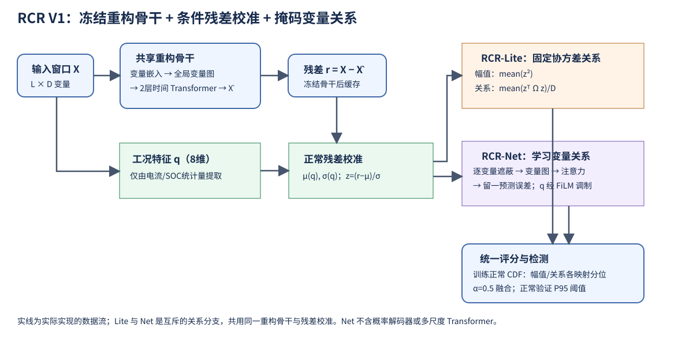

# RCR V1 模型与消融对比报告

**状态：主比较已有结果，LFP 消融与 Brand3 五折仍未完成；只把完成评估的单元填为数值。**

## 模型架构与命名

这里的 CDF 是正常训练分数的经验累积分布函数：将分数映射为它在正常样本中的分位位置，再融合不同量纲的幅值与关系分数。例如 0.95 表示高于约 95% 的训练正常分数；它不是新模型，也不使用测试标签。极端值都可能映射到上界 1，故需注意饱和。

共享骨干为“变量嵌入 → 全局变量图 → 2 层时间 Transformer → 均值重构”。残差经电流/SOC 的 8 维工况统计量做正常均值/尺度校准。Lite 用 Ledoit–Wolf 精度矩阵二次型衡量变量关系；Net 对每个残差坐标做遮蔽留一预测，使用变量图、1 层变量注意力及可选条件 FiLM。两条关系分支是互斥对照，不是串联；Raw、Scale、Lite、Net 共用骨干，不是四套独立模型。幅值与关系分数各由训练正常经验 CDF 映射后固定 α=0.5 融合，阈值只用正常验证集。**实际实现不含概率解码器、多尺度 Transformer 或原计划的 newC3 模块。**详见 [PROTOCOL.md](PROTOCOL.md)。

**条件消融**固定重构骨干与关系建模主形式，改变工况信息的使用方式：无条件、充放电 one-hot、连续电流/SOC 统计量，以及关系头是否使用 FiLM。它检验收益是否来自工况校准或条件调制。

**架构消融**固定工况定义与评分协议，移除或替换模型的结构部件：骨干变量图、时间 Transformer，以及 Lite/Net 关系建模。它检验表征与关系结构本身是否必要。前者改变“如何使用工况”，后者改变“由什么结构学习”。

实验采用正常充放电混合、VIN隔离，seed3407。RCR只在正常数据训练，epoch由正常验证loss选择；主融合alpha=0.5，阈值由正常验证片段P95/P99确定，不使用测试标签挑alpha、epoch或阈值。

## 比较边界

- † 为既有预算参考：10epoch、最多100k训练窗口；RCR为全量正常训练、backbone最多50epoch及关系头最多30epoch、patience8。两者不是等训练预算，不能将全部差异归因于结构。
- 主机制比较是同一冻结backbone与校准下的Raw/Scale/Lite/Net。Net是否超过Lite必须独立报告，不能只比较原MTAD-GAT。
- TranAD保留原生10点窗口，其余方法32点，stride4；测试使用共同长度至少32点的样本。LFP排除了TranAD独有的一个短片段，见参考产物记录。
- LFP/NCM分别训练，不是零样本迁移。单seed与反复使用公开研究队列限制确认性结论。

## Brand3 严格正常验证：五折结果

使用车辆隔离、训练集 MinMax、车辆 Top-5% 聚合和正常验证车辆 P95 阈值。下表为 fold 0–4 五折算术均值；单元格顺序为 AUROC / AP / F1 / Recall / FPR。**粗体**为该指标最高值（FPR 为最低值），不代表统计显著性或综合最优。除 PatchAD、DCdetector 为适配 patch 使用 128 点窗口外，均使用 127 点窗口。参考模型 10 epoch/最多 100k 窗口，与 RCR 全量训练预算不等。

| Brand3 方法 | fold 0–4 均值 |
| --- | --- |
| MTAD-GAT：变量/时间图注意力＋预测/重构 † | 0.9251 / 0.8714 / 0.5899 / 0.6000 / 0.1105 |
| TranAD：双阶段自条件 Transformer 重构 † | 0.8934 / 0.8509 / 0.6316 / 0.5778 / 0.1111 |
| Anomaly Transformer：时间关联差异检测 † | 0.7611 / 0.5473 / 0.1267 / 0.0889 / 0.0778 |
| DCdetector：双注意力对比检测 † | 0.1689 / 0.2330 / 0.0000 / 0.0000 / 0.0550 |
| PatchAD：多尺度 Patch 表征检测 † | 0.6767 / 0.6039 / 0.2291 / 0.1556 / **0.0444** |
| OmniAnomaly：概率 GRU-VAE 重构 † | 0.6815 / 0.4973 / 0.1379 / 0.0889 / 0.0778 |
| Raw：变量图＋时间 Transformer 重构误差 | **0.9255** / 0.8680 / 0.6851 / 0.6667 / 0.1327 |
| Scale：Raw 残差经工况均值/尺度校准 | 0.9240 / 0.8728 / **0.7236** / **0.6889** / 0.0994 |
| Joint-only：校准残差的固定协方差二次型 | 0.9114 / **0.8733** / 0.6939 / **0.6889** / 0.1556 |
| RCR-Lite：校准幅值＋固定协方差关系融合 | 0.9120 / 0.8543 / 0.7007 / 0.6667 / 0.1111 |
| Lite 无条件：全局残差校准＋固定协方差关系 | 0.9146 / 0.8615 / 0.6855 / 0.6444 / 0.1111 |
| RCR-Net：校准幅值＋条件 FiLM 掩码变量关系网络 | 0.9118 / 0.8561 / 0.6294 / 0.5778 / 0.1000 |
| Net 无 FiLM：校准幅值＋不调制的掩码变量关系网络 | 0.9009 / 0.8376 / 0.6524 / 0.6000 / 0.1000 |

五折中，Raw 的平均 AUROC 最高（0.9255），Joint-only 的平均 AP 最高（0.8733），Scale 的平均 F1 最高（0.7236）。MTAD-GAT 的 AUROC 也达到 0.9251，但 F1 为 0.5899。Net 的 F1 低于 Lite（0.6294 对 0.7007），且五折中三折更低、两折相同；FiLM 也未显示稳定收益（Net 无 FiLM 的 F1 为 0.6524）。这些结果不支持“更复杂的关系头在 Brand3 上稳定优于简单校准”的结论。PatchAD 的 FPR 最低，但 Recall 仅 0.1556；车辆级样本量较小，且参考模型训练预算与部分窗口长度不同，跨模型差异只能作辅助比较。

## 正常验证P95阈值结果

单元格顺序：AUROC / AP / F1 / Recall / FPR。全部为比例；**粗体**为本表该数据集、该指标的最优数值（并列均标），不代表统计显著性或综合最优。`‡` 表示仅有汇总指标的初步结果，暂不用于确认性结论。

| 模型/消融 | LFP | NCM |
| --- | --- | --- |
| MTAD-GAT：变量/时间图注意力＋预测/重构 † | 0.6231 / 0.7245 / 0.3638 / 0.2318 / 0.0531 | 0.7400 / 0.8029 / 0.5042 / 0.3462 / 0.0338 |
| TranAD：双阶段自条件 Transformer 重构 † | 0.7457 / 0.7814 / 0.3380 / 0.2117 / 0.0512 | 0.7288 / 0.7922 / 0.4657 / 0.3161 / 0.0517 |
| Anomaly Transformer：时间关联差异检测 † | **0.8137** / **0.8240** / 0.4223 / 0.2780 / **0.0481** | 0.4699 / 0.5625 / 0.0611 / 0.0322 / **0.0285** |
| DCdetector：双注意力对比检测 † | 0.4656 / 0.5330 / 0.0554 / 0.0296 / **0.0481** | 0.5607 / 0.5925 / 0.1071 / 0.0587 / 0.0457 |
| PatchAD：多尺度 Patch 表征检测 † | 0.6645 / 0.6976 / 0.3379 / 0.2148 / 0.0700 | 0.4814 / 0.5582 / 0.0849 / 0.0455 / 0.0311 |
| OmniAnomaly：概率 GRU-VAE 重构 † | 0.5922 / 0.6759 / 0.2761 / 0.1681 / 0.0619 | 0.7023 / 0.7581 / 0.3226 / 0.1977 / 0.0351 |
| Raw：变量图＋时间 Transformer 重构误差 | 0.6147 / 0.7387 / 0.4521 / 0.3056 / 0.0575 | 0.7931 / 0.8602 / 0.6777 / 0.5412 / 0.0702 |
| Scale：Raw 残差经工况均值/尺度校准 | 0.7715 / 0.8113 / 0.4656 / 0.3171 / 0.0563 | 0.8189 / 0.8755 / 0.6831 / 0.5412 / 0.0543 |
| Scale＋幅值 CDF：条件校准误差映射正常分位 | 0.7751 / 0.8135 / 0.4621 / 0.3136 / 0.0544 | 0.8189 / 0.8754 / 0.6851 / 0.5433 / 0.0536 |
| RCR-Lite：校准幅值＋固定协方差关系融合 | 0.7565 / 0.8024 / 0.4505 / 0.3036 / 0.0550 | 0.8212 / **0.8768** / 0.6853 / 0.5444 / 0.0556 |
| RCR-Net 无 FiLM：掩码变量关系网络不加条件调制 | 待完成 | 0.8197 / 0.8754 / 0.6827 / 0.5412 / 0.0556 |
| RCR-Net：校准幅值＋条件 FiLM 掩码变量关系网络 | 0.7765 / 0.8235 / **0.4882** / **0.3362** / 0.0512 | **0.8231** / 0.8762 / 0.6810 / 0.5375 / 0.0517 |
| Lite 无条件：全局残差校准＋固定协方差关系 | 待完成 | 0.8058 / 0.8679 / **0.6876** / **0.5502** / 0.0629 |
| Lite 充放电 one-hot：离散工况校准＋固定关系 | 待完成 | 0.8073 / 0.8688 / 0.6846 / 0.5449 / 0.0589 |
| Net 无全部条件：全局残差校准＋无 FiLM 关系头 | 待完成 | 0.8049 / 0.8655 / 0.6776 / 0.5359 / 0.0576 |
| Net 充放电 one-hot：离散工况校准＋关系头 | 待完成 | 0.8077 / 0.8680 / 0.6767 / 0.5338 / 0.0550 |
| Net 连续条件线性 FiLM：线性调制掩码关系头 | 待完成 | 0.8204 / 0.8752 / 0.6796 / 0.5365 / 0.0530 |
| Net 无骨干变量图：条件掩码关系头＋无图重构骨干 | 待完成 | 0.7889 / 0.8470 / 0.6227 / 0.4715 / 0.0536 ‡ |
| Raw 无骨干变量图：无图重构骨干误差 | 待完成 | 0.7757 / 0.8397 / 0.5981 / 0.4440 / 0.0510 ‡ |
| A0：无变量图/无时间 Transformer 骨干＋Lite | 待完成 | 0.7407 / 0.7525 / 0.2084 / 0.1205 / 0.0450 ‡ |
| A1：仅变量图骨干（移除时间 Transformer）＋Lite | 待完成 | 0.7106 / 0.7486 / 0.2528 / 0.1485 / 0.0331 ‡ |

NCM 架构消融已并入上表，无需重复列一张表。初步结果中，无变量图的 Net F1 为 0.6227，低于完整 RCR-Net 的 0.6810；A0/A1 的 Lite F1 分别为 0.2084/0.2528。跨 seed 稳定性尚未知。

## 预设主比较：RCR-Net − RCR-Lite

- LFP：auroc +0.0199, ap +0.0211, f1 +0.0377, recall +0.0326, fpr -0.0038。
- NCM：auroc +0.0019, ap -0.0007, f1 -0.0043, recall -0.0069, fpr -0.0040。

上述差值不自动证明成功。尤其F1/Recall提高若伴随FPR上升，不是等误报预算增益；单个setting正向也不满足方案要求的跨setting稳定优势。

## 低动态高内阻与其他故障

主机制四组的分层表保持同一个正常验证阈值；不在组内重调阈值。单元格为 Recall / 同工况正常 FPR / AUROC。**粗体**为同一故障分层、同一数据集各指标的最优值（并列均标）；低 FPR 不等于高综合检测能力。

### 放电低动态 high-resistance

| 方法 | LFP | NCM |
| --- | --- | --- |
| Raw（共享backbone） | 0.7889 / 0.0375 / 0.9487 | 0.4222 / 0.0488 / 0.7289 |
| Scale（条件均值/尺度） | 0.8111 / 0.0387 / 0.9792 | 0.4556 / 0.0413 / 0.7941 |
| RCR-Lite | 0.7667 / 0.0338 / 0.9712 | **0.5222** / **0.0338** / 0.8009 |
| RCR-Net | **0.8333** / **0.0312** / **0.9868** | **0.5222** / 0.0362 / **0.8071** |

### 放电全部 high-resistance

| 方法 | LFP | NCM |
| --- | --- | --- |
| Raw（共享backbone） | 0.8633 / 0.0375 / 0.9763 | 0.5167 / 0.0488 / 0.7688 |
| Scale（条件均值/尺度） | 0.9067 / 0.0387 / 0.9894 | 0.5400 / 0.0413 / 0.8259 |
| RCR-Lite | 0.8600 / 0.0338 / 0.9854 | 0.5700 / **0.0338** / 0.8324 |
| RCR-Net | **0.9233** / **0.0312** / **0.9935** | **0.5767** / 0.0362 / **0.8373** |

### 放电 low-capacity

| 方法 | LFP | NCM |
| --- | --- | --- |
| Raw（共享backbone） | 0.0367 / 0.0375 / 0.3115 | **0.7133** / 0.0488 / 0.9101 |
| Scale（条件均值/尺度） | 0.0400 / 0.0387 / 0.6418 | **0.7133** / 0.0413 / 0.9312 |
| RCR-Lite | **0.0467** / 0.0338 / 0.6520 | **0.7133** / **0.0338** / **0.9356** |
| RCR-Net | **0.0467** / **0.0312** / **0.6652** | 0.6967 / 0.0362 / 0.9336 |

### 放电 self-discharge

| 方法 | LFP | NCM |
| --- | --- | --- |
| Raw（共享backbone） | 0.1950 / 0.0375 / 0.7730 | 0.1875 / 0.0488 / 0.6001 |
| Scale（条件均值/尺度） | 0.2350 / 0.0387 / 0.8394 | 0.1825 / 0.0413 / 0.6075 |
| RCR-Lite | 0.1950 / 0.0338 / 0.8411 | 0.1875 / **0.0338** / 0.6089 |
| RCR-Net | **0.2450** / **0.0312** / **0.8601** | **0.1900** / 0.0362 / **0.6128** |

## CDF 饱和及预算诊断

经验CDF上界为1，极端残差可能映射到相同分位数。train/validation/test各分支饱和比例保存在`cdf_saturation.csv`，不根据测试饱和情况临时更换主评分。

| 数据集 | Backbone实际/最佳epoch | Net实际/最佳epoch | 训练窗口数 |
| --- | --- | --- | --- |
| LFP | 21 / 13 | 30 / 29 | 1543911 |
| NCM | 41 / 33 | 30 / 23 | 426432 |

### 条件scale是否实际发生变化

- LFP：7/7个变量scale近似常数，其中7/7个贴近预设下限0.05。
  此时条件校准相对Raw的排序变化来自正常残差条件均值校正，而不是动态条件方差；共同常数scale本身不改变排序。保留原定下限，不据测试结果重调。
- NCM：7/7个变量scale近似常数，其中7/7个贴近预设下限0.05。
  此时条件校准相对Raw的排序变化来自正常残差条件均值校正，而不是动态条件方差；共同常数scale本身不改变排序。保留原定下限，不据测试结果重调。
