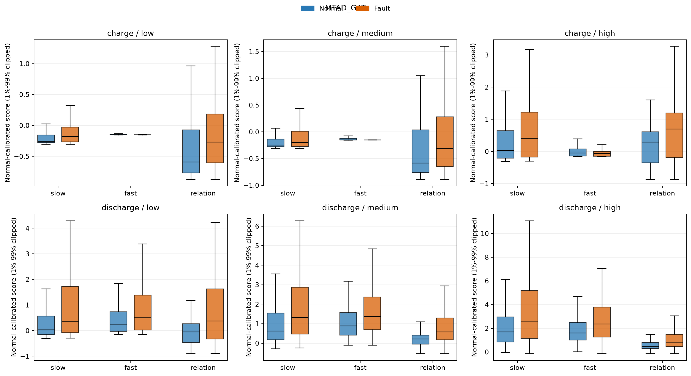
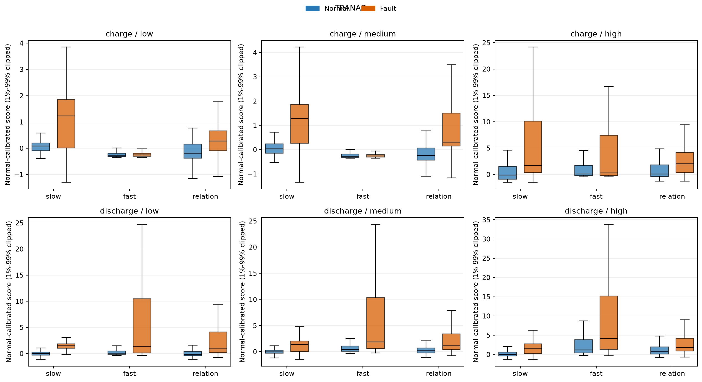

# 冻结残差探针：六组结果与补充诊断

先说结论：这次主要检验“不同工况是否该用不同异常证据”。**目前只在 TranAD 的高动态放电组看到明显换头收益；MTAD-GAT 六组都由关系分数领先。**所以还不支持直接开发通用工况路由模型。

模型没有重训。充电、放电各按电流变化大小分成低/中/高动态。下表每格为 **AUROC / AP**，越高越好；粗体标出三个单项分数中 AUROC 最高的那个。

| MTAD-GAT 工况 | 正常/故障数 | 慢变化 | 快变化 | 关系分数 |
| --- | ---: | ---: | ---: | ---: |
| 充电·低动态 | 265/384 | 0.6170 / 0.7170 | 0.4018 / 0.5295 | **0.6279** / 0.7139 |
| 充电·中动态 | 274/359 | 0.5894 / 0.6909 | 0.3553 / 0.4581 | **0.6123** / 0.7015 |
| 充电·高动态 | 261/250 | 0.5976 / 0.6268 | 0.4429 / 0.4948 | **0.6477** / 0.6917 |
| 放电·低动态 | 310/201 | 0.6148 / 0.5767 | 0.5924 / 0.5497 | **0.6750** / 0.7045 |
| 放电·中动态 | 250/366 | 0.6409 / 0.7221 | 0.6389 / 0.7415 | **0.7134** / 0.8187 |
| 放电·高动态 | 240/433 | 0.6172 / 0.7616 | 0.6174 / 0.7522 | **0.6723** / 0.8111 |

| TranAD 工况 | 正常/故障数 | 慢变化 | 快变化 | 关系分数 |
| --- | ---: | ---: | ---: | ---: |
| 充电·低动态 | 265/384 | 0.6803 / 0.7595 | 0.5470 / 0.5992 | **0.7269** / 0.7894 |
| 充电·中动态 | 274/359 | 0.7391 / 0.7702 | 0.5259 / 0.5595 | **0.8102** / 0.8408 |
| 充电·高动态 | 261/250 | **0.7254** / 0.7115 | 0.5653 / 0.6070 | 0.7241 / 0.7104 |
| 放电·低动态 | 310/201 | 0.7688 / 0.7075 | 0.7457 / 0.7440 | **0.8155** / 0.7769 |
| 放电·中动态 | 250/366 | 0.7570 / 0.8376 | 0.7601 / 0.8414 | **0.7768** / 0.8439 |
| 放电·高动态 | 240/433 | **0.7679** / 0.8650 | 0.7060 / 0.8159 | 0.7107 / 0.8236 |

TranAD 的高动态放电组，慢变化比关系分数高 **0.0573 AUROC、0.0414 AP**；高动态充电只高 0.0013 AUROC，差距太小。MTAD-GAT 没有这样的交叉优势。

## 固定阈值后的误报和漏检

每个分数只用**训练正常样本**确定一个全局 P95 报警阈值，六个测试组都共用它。没有用测试故障标签挑阈值。每格是 **FPR / Recall**，即正常样本误报率 / 故障样本检出率。

| MTAD-GAT 工况 | 慢变化 | 快变化 | 关系分数 |
| --- | ---: | ---: | ---: |
| 充电·低动态 | 0.0% / 0.3% | 0.0% / 0.0% | 0.8% / 8.9% |
| 充电·中动态 | 0.0% / 0.3% | 0.0% / 0.0% | 1.1% / 13.1% |
| 充电·高动态 | 1.5% / 10.4% | 0.0% / 0.0% | 11.5% / 36.4% |
| 放电·低动态 | 1.3% / 12.9% | 0.6% / 10.4% | 0.3% / 35.3% |
| 放电·中动态 | 9.2% / 19.4% | 4.0% / 19.4% | 4.4% / 32.2% |
| 放电·高动态 | 20.0% / 35.3% | 19.2% / 36.0% | 17.1% / 40.2% |

| TranAD 工况 | 慢变化 | 快变化 | 关系分数 |
| --- | ---: | ---: | ---: |
| 充电·低动态 | 3.0% / 6.8% | 0.0% / 0.0% | 0.4% / 9.1% |
| 充电·中动态 | 2.2% / 7.0% | 0.0% / 0.3% | 1.5% / 13.1% |
| 充电·高动态 | 20.7% / 40.8% | 11.9% / 26.8% | 16.9% / 42.4% |
| 放电·低动态 | 1.6% / 18.9% | 1.0% / 30.3% | 0.6% / 33.3% |
| 放电·中动态 | 2.8% / 21.9% | 2.4% / 30.3% | 2.0% / 29.0% |
| 放电·高动态 | 4.6% / 27.7% | 15.4% / 40.0% | 11.7% / 35.3% |

注意：TranAD 高动态放电的慢变化虽然 AUROC 更高，但固定阈值下 Recall 只有 **27.7%**，低于关系分数的 **35.3%**；同时 FPR 也从 11.7% 降至 4.6%。所以“故障排序更好”不等于“当前阈值检出更多”。两个模型都容易漏掉低动态充电故障；高动态正常片段更容易误报。

## 分布图和“事后最佳头”

每张图六个小面板；蓝色为正常、橙色为故障，同一组内比较三种证据。只把**图的显示范围**裁剪到 1%–99%，计算指标时仍使用全部原值。

如果**事后查看测试标签**，每组挑 AUROC 最高的单项分数，MTAD-GAT 六组还是全选关系分数，组均 AUROC 比始终用关系分数提高 **0**。TranAD 四组选关系分数、两个高动态组选慢变化，六组平均 AUROC 从 **0.7607** 增至 **0.7704**，提高 **0.0098**，主要来自高动态放电。这只是诊断上界，不是可部署的 router 成绩；组均 AUROC 也不是全体样本的 AUROC。

完整五种分数（含固定平均和无标签规则路由）的逐组统计见 `runs/internal/residual_router_probe_lfp_seed3407/{mtad_gat,tranad}/complete_diagnostics.csv`；事后选择见同目录 `best_head_oracle_diagnostic.csv`。可复现脚本是 `src/runners/summarize_frozen_residual_router_probe.py`。

## 与最初方案的差别

已完成：冻结两个模型、取 7 维重构残差、用训练正常残差拟合 Ledoit–Wolf 关系分数、充放电与动态分层、AUROC/AP/FPR/Recall、正常/故障分布图、固定平均、事后最佳头诊断、无故障标签的简单路由。

未完成的不是“结果被藏起来”，而是两个额外稳健性项：这次 slow 是连续 **5 个抽样端点**的移动平均，端点相隔 4 个原始采样点，**没有**做 k=8/16/32 的全时序尺度消融，也没有另算差分分数。残差也只取每个抽样窗口的末端，不是整段所有时间点。若要对“慢变证据”下强结论，还需要补这些尺度检查。
