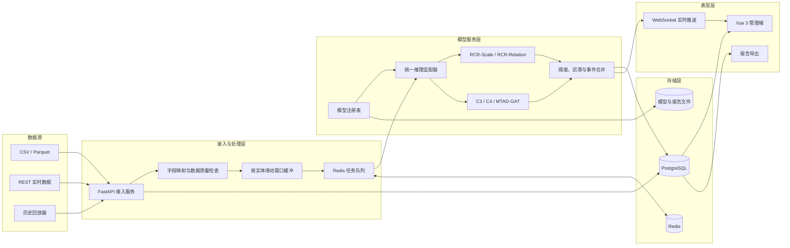
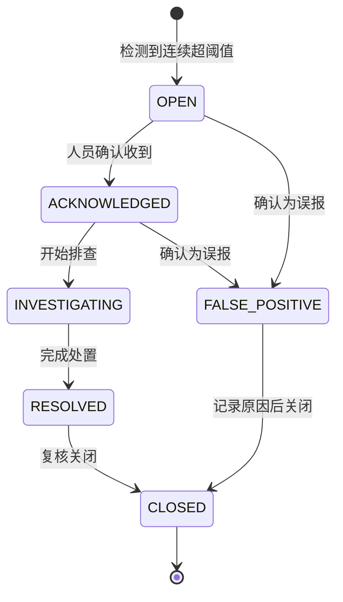
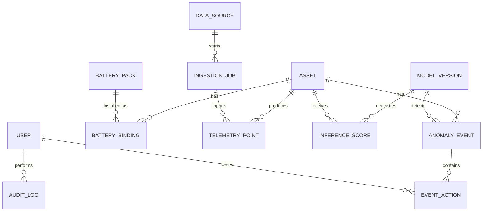
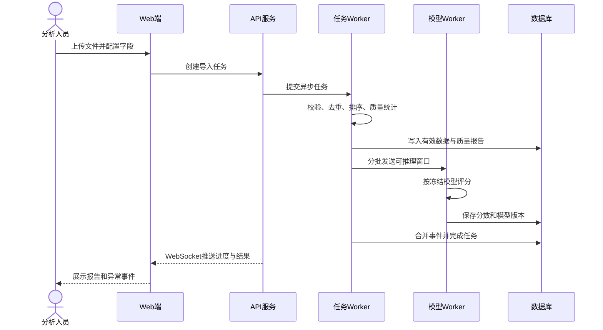

# 面向多工况的动力电池异常监测与风险分析系统设计

版本：V1.0  
日期：2026-10-17  
项目代号：BatteryGuard-RCR

## 1. 项目定位

本系统面向动力电池多变量运行数据，提供数据接入、数据质量检查、异常检测、异常事件管理、原因线索展示、模型版本管理和分析报告导出能力。系统把本仓库的条件残差校准与残差关系模型封装为可部署检测服务，同时保留 MTAD-GAT、C3、C4 等模型的统一接入能力。

系统的业务输出是“异常风险及其证据”，不是未经人工确认的故障类型诊断。模型发现的是统计分布偏离或变量关系破坏；告警页面必须明确区分模型告警、人工确认故障和已排除误报。

论文中的系统题目建议使用：

> 面向多工况的动力电池多变量异常监测与风险分析系统设计与实现

系统与算法研究的关系如下：

- 算法章节回答“如何降低工况变化引起的误报，并发现变量关系异常”。
- 系统章节回答“如何将算法可靠地接入数据、管理版本、形成可复核告警并完成业务闭环”。
- 系统采用模型无关的推理接口，最终论文选用 RCR、C3 或 C4 时无需重写业务模块。

## 2. 设计目标与边界

### 2.1 设计目标

1. 支持 CSV/Parquet 历史数据导入和 REST 流式数据接入。
2. 按车辆或电池实体维护滑动窗口，执行数据校验、归一化和模型推理。
3. 展示原始异常分数、工况校准分数、变量关系分数、阈值和主要贡献变量。
4. 将连续超阈值窗口合并为异常事件，支持确认、误报、处理中、已关闭等处置状态。
5. 保存模型版本、输入模式、阈值来源、文件哈希和推理记录，使每次告警可复现。
6. 支持运行概览、车辆详情、告警中心、模型管理和报告导出。
7. 提供可量化的功能、性能、可靠性和模型一致性验收标准。

### 2.2 V1 实施边界

V1 聚焦可演示、可测试、可写入硕论的闭环，不在系统内实现模型训练平台、自动故障维修决策、车端固件下发或大规模车联网消息平台。训练仍由现有科研流水线完成，系统只注册经过审计的冻结模型包。

V1 必做范围：

- 用户登录与角色控制；
- 车辆、电池包和数据源管理；
- 历史文件导入及进度查询；
- 在线数据接收与回放模拟；
- 数据质量监控；
- 模型注册、激活和回滚；
- 异常评分、事件合并和告警处置；
- 实时监控、车辆详情和模型解释页面；
- CSV/PDF 分析报告导出；
- 操作审计和模型推理追溯。

V1 可选范围：

- MQTT/Kafka 数据接入；
- 短信、邮件或企业微信通知；
- 多租户管理；
- 在线模型训练；
- 基于人工反馈的主动学习。

## 3. 用户与典型场景

| 角色 | 主要职责 | 核心操作 |
| --- | --- | --- |
| 系统管理员 | 维护用户、角色和基础配置 | 用户管理、权限配置、审计日志、系统健康检查 |
| 算法工程师 | 管理冻结模型及阈值 | 注册模型、校验模型包、灰度激活、模型对比、回滚 |
| 监控人员 | 观察车辆状态并处置告警 | 查看大盘、筛选告警、确认/排除、填写处置意见 |
| 分析人员 | 分析车辆与故障模式 | 查看趋势、变量贡献、工况分层、导出分析报告 |

核心场景：

1. 分析人员上传车辆历史数据，系统检查字段、时间顺序、缺失率和取值范围，形成导入报告。
2. 系统按实体构造窗口并调用激活模型，记录各分支分数、模型版本和阈值。
3. 连续多个高风险窗口被合并成一个事件，监控人员在告警中心处理。
4. 监控人员打开事件详情，查看异常发生前后的电流、SOC、电压、温度、残差和贡献变量。
5. 算法工程师注册新模型，系统使用固定样本执行兼容性与回归检查，通过后才允许激活。
6. 答辩演示时使用历史数据回放模拟在线数据，完整展示“数据进入—评分—告警—解释—处置—报告”闭环。

## 4. 总体架构

系统采用前后端分离的模块化单体架构。业务 API 和模型推理在进程层面分离，减少深度学习依赖对普通业务请求的影响；数据库、缓存和对象文件各自承担适合的数据类型。



### 4.1 技术选型

| 层次 | 技术 | 选择理由 |
| --- | --- | --- |
| 前端 | Vue 3、TypeScript、Vite、Element Plus、ECharts、Pinia | 国内工程资料丰富，适合管理系统和多变量时序图表 |
| 后端 | FastAPI、Pydantic、SQLAlchemy、Alembic | 与现有 Python/PyTorch 模型直接集成，接口文档可自动生成 |
| 异步任务 | Celery、Redis | 文件导入、批量推理和报告生成不阻塞 Web 请求 |
| 模型推理 | PyTorch、NumPy、现有 FrozenRCRDetector 适配层 | 复用已冻结模型及预处理，减少线上线下不一致 |
| 业务数据库 | PostgreSQL | 支持事务、索引、JSONB 和时间分区；开发环境可用 SQLite 简化启动 |
| 文件存储 | 本地受控目录；部署时可替换 MinIO | 模型权重、原始导入文件和报告不应直接存入数据库 |
| 部署 | Docker Compose、Nginx | 单机即可完整演示，组件边界清楚，后续可独立扩展模型 worker |

选择模块化单体而不是微服务的原因是当前系统规模有限，硕论周期内更需要保证业务闭环、可复现性和测试质量。模型 worker 独立运行已经隔离了主要计算负载，后续确有并发需求时再拆分服务。

## 5. 功能模块设计

### 5.1 身份认证与权限

- 用户名和密码登录，密码使用 Argon2 或 bcrypt 哈希保存。
- 访问令牌使用短时 JWT，刷新令牌支持主动失效。
- 采用 RBAC：管理员、算法工程师、监控人员、只读分析人员。
- 模型激活、阈值变更、告警关闭、数据删除和报告导出进入审计日志。

### 5.2 资产管理

- 管理车辆、电池包、品牌、化学体系、投运日期和状态。
- 一个车辆可关联一个当前电池包；历史更换关系单独保存。
- 资产详情展示最近数据时间、模型版本、风险等级和未关闭事件数。
- 支持按品牌、化学体系、车队和运行状态筛选。

### 5.3 数据接入与质量检查

文件导入流程：

1. 上传文件并计算 SHA-256；
2. 选择或自动识别字段映射；
3. 检查必需字段、数据类型、时间顺序、重复点、缺失率和非有限值；
4. 按训练时保存的输入规范检查单位和合理范围；
5. 生成预览和质量报告；
6. 用户确认后写入时序表并提交批量推理任务。

在线接入流程：

- `POST /api/v1/telemetry` 接收单条或小批量数据；
- 每条数据带 `asset_code`、`timestamp` 和传感器字段；
- 使用请求 ID 保证幂等，重复数据更新或拒绝由数据源策略决定；
- 数据按实体和时间排序进入滑动窗口；
- 缺失或乱序超出允许范围时记录质量事件，不静默填充。

数据质量指标包括完整率、重复率、乱序数、采样间隔分布、越界值数、最后更新时间和可推理窗口比例。

### 5.4 模型注册与版本管理

模型包必须包含：

- `manifest.json`：模型 ID、算法、版本、训练数据说明、窗口长度、步长、特征顺序、控制变量索引、归一化方式、阈值及来源；
- 模型权重和必要的统计校准文件；
- 输入归一化参数；
- 固定回归样本及期望输出摘要；
- 所有文件的 SHA-256；
- 训练或实验协议标识。

注册状态采用 `UPLOADED → VALIDATING → READY → ACTIVE → RETIRED/FAILED`。同一数据模式下只能有一个默认激活版本。激活是数据库指针切换，不覆盖旧模型，因此可以回滚和复现历史告警。

统一模型接口：

```python
class DetectorAdapter(Protocol):
    def metadata(self) -> ModelMetadata: ...
    def validate_input(self, values, columns) -> None: ...
    def score_windows(self, values, *, details=False) -> ScoreBatch: ...
```

`ScoreBatch` 至少返回：

- `raw_score`：原始重构误差；
- `magnitude_score`：条件校准后的幅值分数；
- `relation_score`：变量关系分数，可为空；
- `final_score`：该模型声明的最终分数；
- `threshold` 与 `threshold_source`；
- `prediction`；
- `feature_contributions`；
- `quality_flags`。

RCR 适配器调用现有 `FrozenRCRDetector`。默认展示 Scale 或模型清单指定的正式分数；复杂关系分支只有在对应冻结模型注册并激活时才参与最终判定。C3/C4 适配器复用其已保存配置和预测入口，不在 API 层重新解释模型参数。

### 5.5 在线推理

设实体 (v) 的有序观测为 (x_t\in\mathbb{R}^D)，模型窗口长度为 (L)。系统维护：

\[
X_t=[x_{t-L+1},\ldots,x_t]\in\mathbb{R}^{L\times D}.
\]

窗口满足字段完整、时间连续和模型输入规范后进入推理。对 RCR，系统记录：

\[
e_t=X_t-\hat X_t,
\qquad
z_t=\frac{e_t-\mu(q_t)}{\sigma(q_t)},
\qquad
s_{mag}=\operatorname{mean}(z_t^2).
\]

启用关系分支时，再得到 (s_{rel})。系统只采用模型包中冻结的 CDF、融合参数和正常验证阈值，不根据线上未知标签自动搜索阈值。

推理结果必须与原始窗口终点、资产、模型版本和阈值版本绑定。为了控制存储量，数据库保存窗口摘要与每变量贡献；完整窗口由原始时序数据和时间范围重建，必要时将事件快照写入对象存储。

### 5.6 事件形成与告警处置

单窗口超阈值容易形成告警风暴，因此使用双阈值迟滞和事件合并：

- 当分数连续 `start_count` 个窗口超过高阈值，创建异常事件；
- 事件期间分数偶尔下降但仍高于低阈值时保持开启；
- 连续 `end_count` 个窗口低于低阈值后结束事件；
- 相邻事件间隔小于 `merge_gap` 时合并；
- 数据中断不自动判正常，事件标记为 `DATA_INTERRUPTED` 等待恢复或人工处理。

事件状态机：



严重度由“峰值与阈值的比值、持续时间、涉及变量数”按照预设规则产生，页面必须标明它是系统风险级别，不等于故障严重度或安全等级。

### 5.7 异常解释

事件详情给出四类证据：

1. 输入曲线：异常前后电流、SOC、电压和温度。
2. 分数分解：Raw、Magnitude、Relation、Final 和对应阈值。
3. 变量贡献：标准化残差平方或 LOO 预测误差在变量维的占比。
4. 工况信息：当前窗口的电流/SOC 八维描述及其相对正常训练分布的位置。

解释页面使用“贡献较大的变量”“关系偏离较大的变量”等措辞，不把注意力权重或残差贡献直接称为故障原因。若模型不提供某项证据，前端显示“不适用”，不使用零值伪装为已计算结果。

### 5.8 可视化与报告

主要页面：

| 页面 | 主要内容 |
| --- | --- |
| 登录页 | 登录、会话失效提示 |
| 运行总览 | 在线资产数、风险分布、今日事件、数据质量、最近告警 |
| 资产列表 | 品牌、化学体系、状态、最新分数、未处理事件 |
| 资产详情 | 多变量曲线、分数曲线、工况、事件时间轴、模型版本 |
| 告警中心 | 条件筛选、批量确认、负责人、状态、处置记录 |
| 事件详情 | 上下文曲线、分支分数、变量贡献、人工结论和审计轨迹 |
| 数据导入 | 文件上传、字段映射、质量预览、任务进度和失败原因 |
| 模型管理 | 模型版本、输入模式、哈希、阈值来源、验证状态、激活与回滚 |
| 系统审计 | 登录、模型切换、阈值变更、告警处置和报告导出记录 |

报告分为资产日报、事件报告和模型运行报告。事件报告至少包含资产信息、事件区间、模型版本、阈值来源、分数曲线、主要贡献变量、数据质量、处置记录和导出时间。

## 6. 数据库设计

### 6.1 核心实体关系



### 6.2 主要表

| 表 | 关键字段 | 说明 |
| --- | --- | --- |
| `users` | `id, username, password_hash, role, status` | 用户和角色 |
| `assets` | `id, asset_code, brand, chemistry, status` | 车辆或监测实体 |
| `battery_packs` | `id, pack_code, chemistry, rated_capacity` | 电池包档案 |
| `battery_bindings` | `asset_id, pack_id, start_at, end_at` | 电池包装车历史 |
| `data_sources` | `id, name, source_type, schema_id` | 文件、REST 或回放数据源 |
| `ingestion_jobs` | `id, source_id, file_hash, status, summary, error` | 导入任务和质量摘要 |
| `telemetry_points` | `asset_id, timestamp, values, quality_flags, job_id` | 原始时序；`values` 使用 JSONB，正式固定模式可拆列 |
| `model_versions` | `id, name, version, algorithm, manifest, artifact_uri, sha256, status` | 冻结模型注册表 |
| `model_activations` | `id, model_id, schema_id, activated_at, deactivated_at` | 激活与回滚历史 |
| `inference_scores` | `asset_id, endpoint, model_id, raw, magnitude, relation, final, threshold, prediction, contributions` | 窗口级分数和解释摘要 |
| `anomaly_events` | `id, asset_id, model_id, start_at, end_at, peak_score, severity, status` | 合并后的异常事件 |
| `event_actions` | `event_id, user_id, action, comment, created_at` | 处置和人工反馈 |
| `audit_logs` | `user_id, action, resource_type, resource_id, before, after, request_id` | 系统审计 |

索引设计：

- `telemetry_points(asset_id, timestamp)` 唯一索引并按月分区；
- `inference_scores(asset_id, endpoint, model_id)` 唯一索引；
- `anomaly_events(status, severity, start_at)` 复合索引；
- `model_versions(name, version)` 唯一索引；
- `ingestion_jobs(file_hash, source_id)` 用于重复文件检测。

## 7. API 设计

所有接口使用 `/api/v1` 前缀，统一返回 `request_id`。错误体包含机器可读错误码、中文提示和可选字段错误列表。

### 7.1 核心接口

| 方法与路径 | 用途 | 权限 |
| --- | --- | --- |
| `POST /auth/login` | 登录 | 公开 |
| `GET /assets` | 分页查询资产 | 全部登录用户 |
| `GET /assets/{id}/overview` | 资产曲线、分数及事件摘要 | 全部登录用户 |
| `POST /telemetry` | 接收在线数据 | 数据源凭据 |
| `POST /ingestion-jobs` | 创建文件导入任务 | 管理员、分析人员 |
| `GET /ingestion-jobs/{id}` | 查询进度与质量报告 | 管理员、分析人员 |
| `GET /events` | 筛选异常事件 | 全部登录用户 |
| `GET /events/{id}` | 查询事件详情与证据 | 全部登录用户 |
| `POST /events/{id}/actions` | 确认、处置、误报、关闭 | 监控人员、管理员 |
| `POST /models` | 注册模型包 | 算法工程师、管理员 |
| `POST /models/{id}/validate` | 执行兼容性和回归检查 | 算法工程师、管理员 |
| `POST /models/{id}/activate` | 激活模型 | 算法工程师、管理员 |
| `POST /models/{id}/rollback` | 回滚到上一版本 | 算法工程师、管理员 |
| `GET /dashboard/summary` | 总览统计 | 全部登录用户 |
| `GET /reports/events/{id}` | 导出事件报告 | 监控人员、分析人员 |
| `GET /ws/alerts` | 实时告警推送 | 全部登录用户 |

### 7.2 在线数据示例

```json
{
  "request_id": "8f15d58a-4ba5-4c1e-8e6f-c948b95d8c33",
  "asset_code": "EV-00031",
  "timestamp": "2026-10-17T10:30:01+08:00",
  "measurements": {
    "SUM_VOLTAGE": 378.4,
    "SUM_CURRENT": -42.1,
    "SOC": 63.2,
    "MAX_CELL_VOLT": 3.842,
    "MIN_CELL_VOLT": 3.791,
    "MAX_TEMP": 36.7,
    "MIN_TEMP": 32.5
  }
}
```

服务端不依赖 JSON 字段顺序，而是根据模型 `feature_columns` 显式重排。字段缺失、单位不符或出现非有限值时拒绝进入推理并生成质量记录。

## 8. 关键业务流程

### 8.1 历史数据批量检测



### 8.2 模型发布

1. 上传模型包，保存为不可变文件并计算哈希。
2. 验证 manifest、特征顺序、窗口形状和依赖版本。
3. 在固定回归样本上运行推理，结果与模型包期望摘要比较。
4. 使用少量系统测试数据完成批量和单批一致性检查。
5. 标记为 `READY`，由有权限人员激活。
6. 新请求使用新模型；已有事件仍保留原模型 ID。
7. 若运行失败率或延迟异常，管理员回滚激活指针。

## 9. 非功能设计

### 9.1 性能目标

性能目标在论文中必须通过实际部署环境测试，不能只写设计值：

- 单车稳定流式接入下，形成一个完整窗口后的推理响应 P95 不高于 1 秒；
- 10 万条七维遥测数据导入任务在普通开发机上可完成且内存有界；
- 总览页面查询最近 24 小时聚合数据的服务端 P95 不高于 500 ms；
- 普通业务 API 在不含模型推理时 P95 不高于 300 ms；
- 模型 worker 支持配置微批量和 CPU/GPU 设备，显存不足时任务失败并保留明确错误，不静默切换结果协议。

### 9.2 可靠性

- 导入和推理任务支持断点状态与失败重试，重试不得产生重复分数或事件；
- 数据库事务保证事件状态与处置记录一致；
- 模型包只读挂载，激活操作不覆盖文件；
- 服务启动时校验当前激活模型的文件哈希；
- 关键后台任务有心跳、超时和失败原因；
- 每日备份业务数据库和模型 manifest，模型权重采用版本化文件归档。

### 9.3 安全性

- 密码不明文保存；API 按角色鉴权；文件上传限制扩展名、大小和解析路径；
- 遥测接入使用独立数据源令牌，不使用用户令牌；
- SQL 使用 ORM 参数化查询；前端文本输出做转义；
- 模型注册拒绝任意 Python pickle，只接受系统支持的结构及 `state_dict`/受控统计文件；
- 日志不输出密码、令牌、完整模型权重或原始敏感车辆标识；
- 数据导出、模型切换和告警关闭必须留存审计记录。

### 9.4 可复现性

任一异常事件应可由以下信息重建：资产 ID、时间范围、原始数据哈希、字段模式、预处理版本、模型 ID、模型文件哈希、阈值及来源、推理参数、分支分数和事件合并参数。

## 10. 前后端工程结构

建议在仓库中新建 `system/`，与科研训练代码隔离：

```text
system/
├── backend/
│   ├── app/
│   │   ├── api/              # REST与WebSocket路由
│   │   ├── core/             # 配置、认证、日志、错误码
│   │   ├── db/               # ORM模型、迁移、仓储
│   │   ├── ingestion/        # 字段映射与质量检查
│   │   ├── inference/        # 统一模型适配器与窗口管理
│   │   ├── events/           # 迟滞、合并、状态机
│   │   ├── reports/          # CSV/PDF报告
│   │   └── tasks/            # Celery任务
│   ├── tests/
│   └── pyproject.toml
├── frontend/
│   ├── src/
│   │   ├── api/
│   │   ├── components/
│   │   ├── views/
│   │   ├── stores/
│   │   └── router/
│   └── package.json
├── deploy/
│   ├── docker-compose.yml
│   ├── nginx.conf
│   └── env.example
└── README.md
```

`src/` 中现有算法代码继续作为科研核心，系统通过适配器调用，不把 Web 依赖加入训练入口。生产模型包复制到受控 artifact 目录，系统不直接扫描 `runs/` 选择“最新模型”。

## 11. 测试与验收方案

### 11.1 功能验收

| 编号 | 验收项 | 通过标准 |
| --- | --- | --- |
| F01 | 文件导入 | 正常文件成功导入；缺字段、乱序、重复和非法值有明确报告 |
| F02 | 在线接入 | 重复 request ID 不产生重复数据和重复事件 |
| F03 | 推理一致性 | 同一冻结模型、同一归一化窗口的系统分数与离线脚本误差不超过预设数值容差 |
| F04 | 模型追溯 | 任一分数可查询模型版本、哈希、阈值及输入时间范围 |
| F05 | 事件合并 | 构造的阈值序列得到预期开始、结束和合并结果 |
| F06 | 权限 | 未授权角色无法激活模型、关闭告警或管理用户 |
| F07 | 回滚 | 回滚后新推理使用旧版本，历史记录保持原模型版本 |
| F08 | 报告 | 导出的事件报告与页面核心字段一致 |

### 11.2 算法集成验收

1. 从现有冻结产物中选择一组正常窗口和异常窗口作为黄金样本。
2. 使用离线入口保存 Raw、Magnitude、Relation 和 Final 分数摘要。
3. 系统注册相同模型包后分别以单窗口、不同 batch size 和历史导入三种方式推理。
4. 比较全部分支分数、阈值和预测结果，不只比较最终告警。
5. 验证字段顺序打乱但字段名正确时结果不变；缺字段时必须失败。
6. 验证 CPU 与 GPU 在声明容差内一致；论文报告实际最大误差。

### 11.3 性能与稳定性验收

- 使用固定硬件、固定数据规模、固定并发和固定模型记录吞吐与 P50/P95/P99；
- 对 1、10、50 个模拟资产执行历史回放，记录任务积压、CPU、内存和可选 GPU 显存；
- 在 worker 中途退出后重启，检查任务恢复、幂等性和事件重复情况；
- 连续运行至少 8 小时的回放测试，记录错误率和资源变化；
- 所有性能结果附硬件、软件版本和测试脚本，不使用浏览器主观感受代替数据。

## 12. 实施计划

| 阶段 | 工作内容 | 可验收产物 |
| --- | --- | --- |
| 第1阶段：骨架 | 后端、前端、数据库迁移、登录、资产管理 | 可登录并管理资产的系统骨架 |
| 第2阶段：数据 | 文件导入、字段映射、质量报告、时序查询 | 一份真实数据可完整导入并展示 |
| 第3阶段：模型 | 模型 manifest、RCR 适配器、回归校验、分数存储 | 系统分数与离线结果一致 |
| 第4阶段：事件 | 双阈值迟滞、事件合并、告警中心、处置记录 | 历史回放能稳定产生并处置事件 |
| 第5阶段：可视化 | 总览、资产详情、事件解释、实时推送 | 完整演示闭环 |
| 第6阶段：工程化 | 模型版本、回滚、审计、报告、容器部署 | 一条命令启动及可追溯报告 |
| 第7阶段：测试 | 功能、算法一致性、性能、稳定性、安全测试 | 系统测试报告和论文图表 |

实施优先级遵循“先闭环、再丰富展示”。若时间不足，先完成单管理员、CSV 导入、RCR-Scale 推理、事件中心、详情页和报告；实时推送、多角色和复杂关系分支可随后补充。

## 13. 论文写作对应关系

系统章节建议组织为：

1. 需求分析：研究背景、用户角色、业务流程、功能和非功能需求。
2. 系统总体设计：分层架构、模块职责、技术选型和部署结构。
3. 数据与接口设计：领域模型、数据库、模型 manifest、API 和异常处理。
4. 核心模块实现：数据质量、滑动窗口、模型适配、事件合并、解释展示。
5. 系统测试：功能测试、推理一致性、并发性能、稳定性和安全性。
6. 系统应用示例：选择若干正常、真实异常和误报案例走完整闭环。

系统章节不能替代算法创新，也不应把工程功能包装成算法贡献。论文可将贡献分为：

- 算法贡献：多工况条件残差校准及经实验支持的关系建模方法；
- 工程贡献：模型版本、阈值来源、数据质量和告警证据的端到端可追溯机制；
- 实证贡献：同一检测协议在离线实验和系统部署中的一致性验证。

## 14. 风险与控制

| 风险 | 后果 | 控制措施 |
| --- | --- | --- |
| 最终算法路线仍可能调整 | 系统与论文模型不一致 | 通过统一适配器和 manifest 解耦业务与模型 |
| 复杂 RCR 关系头跨数据集不稳定 | 系统演示性能下降 | 默认使用经过确认的正式分数；各分支独立展示，不强制融合 |
| 原始数据字段或单位不一致 | 错误输入产生错误告警 | 强制模式、单位、范围和字段顺序校验 |
| 正常验证样本少导致阈值不稳 | 误报率波动 | 显示阈值来源和版本；报告正常分数漂移，不在线用未知标签重调 |
| Web 开发范围过大 | 无法在论文周期完成 | 按 V1 必做范围实施，消息平台和训练平台延期 |
| 页面将模型贡献误解为故障原因 | 产生过度结论 | 使用“异常证据/贡献变量”表述，并保留人工确认状态 |

## 15. 最终验收定义

系统完成应同时满足以下条件：

1. 一份符合模式的真实数据能够从上传进入数据库并形成质量报告。
2. 冻结模型能够通过注册、校验、激活和回滚流程管理。
3. 系统推理与原离线脚本在声明容差内一致。
4. 历史回放能够形成可复核的异常事件，而不是大量孤立窗口告警。
5. 事件详情能解释分数来源、主要贡献变量、工况和模型版本。
6. 人员可完成确认、排查、误报或关闭操作，且全过程可审计。
7. 可导出包含数据、模型、阈值和处置证据的事件报告。
8. 功能、性能、稳定性和权限测试均有可重复脚本和实测结果。

达到以上闭环后，系统才具备硕论“设计、实现、验证”的完整证据；页面数量或微服务数量不作为系统质量的主要判断标准。
